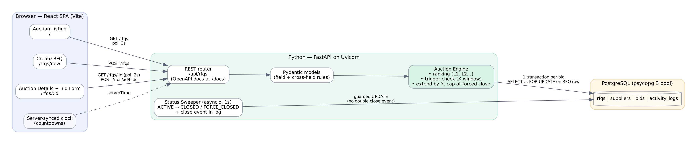

# HLD — British Auction RFQ

## Architecture

| Layer | Tech | Responsibility |
|---|---|---|
| Frontend | React 18 + Vite + React Router | Listing, Create RFQ, Details + Bid form. Polls API (list 3s, details 2s). Countdowns use server time offset. |
| API | Python, FastAPI, Uvicorn | REST endpoints, Pydantic request/response models, consistent error format, OpenAPI docs at `/docs`. |
| Auction Engine | `backend/app/auction.py` | Ranking, trigger evaluation, extension with forced-close cap, status derivation, activity logging. |
| Status Sweeper | asyncio task (1s) in `main.py` lifespan | Moves ACTIVE → CLOSED / FORCE_CLOSED and writes the close event even if nobody is viewing. |
| Database | PostgreSQL via psycopg 3 + connection pool | `rfqs`, `suppliers`, `bids`, `activity_logs`. See [SCHEMA.md](SCHEMA.md). |

## API

| Method | Path | Purpose |
|---|---|---|
| `GET` | `/api/rfqs` | Listing: name/ID, lowest bid (+ carrier), current close, forced close, status |
| `POST` | `/api/rfqs` | Create RFQ with British Auction config (X, Y, trigger) |
| `GET` | `/api/rfqs/{id}` | Details: RFQ + config, ranking (L1..Ln), all bids by price, activity log |
| `POST` | `/api/rfqs/{id}/bids` | Submit quote. Returns rank + extension (if any) |

JSON is camelCase. Errors: `{"error": "...", "details": {"field": "message"}}`
`400` validation · `404` not found · `409` auction not active / duplicate reference ID · `422` quote not lower than supplier's current quote.

## Bid flow (`POST /api/rfqs/{id}/bids`)

Everything below runs in **one PostgreSQL transaction**:

1. Pydantic validates payload (charges ≥ 0 with 2 decimals, transit 1–365 days, dates). Engine checks total > 0 and validity not in the past.
2. `SELECT * FROM rfqs WHERE id = $1 FOR UPDATE` — locks the auction row; concurrent bids on the same RFQ queue here.
3. Reject unless `bid_start_at ≤ now < current_close_at` (ACTIVE).
4. Upsert supplier by carrier name (case-insensitive unique index).
5. `before` = current ranking. Supplier's new total must be **strictly lower** than their own current quote.
6. Insert bid (`total_amount` is a generated column). `after` = new ranking. Log `BID_SUBMITTED`.
7. If `now ≥ current_close_at − X` → evaluate trigger:

   | Trigger | Fires when |
   |---|---|
   | `BID_RECEIVED` | any bid in window |
   | `ANY_RANK_CHANGE` | any supplier's rank differs between `before` and `after` (new supplier entering = change) |
   | `L1_CHANGE` | `before[0].supplier ≠ after[0].supplier` |

8. If fired: `new_close = min(current_close_at + Y, forced_close_at)`. If `new_close > current_close_at` → update, `extension_count++`, log `TIME_EXTENDED` with old/new close + reason. If already at forced close → no extension, note it on the bid log line.
9. Commit (releases the lock).

Trigger hierarchy is consistent: every L1 change ⊂ rank change ⊂ bid received.

## Rules

| Rule | Where enforced |
|---|---|
| Forced close > bid close | API validation + DB `CHECK chk_forced_after_close` |
| Extension never exceeds forced close | `min(...)` in engine + DB `CHECK chk_current_close_range` |
| Extension adds Y to the **current** close time (window moves with it) | engine |
| No bids before start / after current close | engine (`409`) |
| Ranking = each supplier's lowest quote; tie → earlier bid wins | `DISTINCT ON` + `ROW_NUMBER()` query |
| Total = freight + origin + destination | DB generated column |

## Status

Derived from time — single source of truth; the stored `status` column is a cache:

| Status | Condition |
|---|---|
| Upcoming | `now < bid_start_at` |
| Active | `bid_start_at ≤ now < current_close_at` |
| Closed | `now ≥ current_close_at` and `current_close_at < forced_close_at` |
| Force Closed | `now ≥ current_close_at` and `current_close_at = forced_close_at` (extensions hit the hard stop) |

The sweeper uses `UPDATE … WHERE status = <old>` so the close event is written exactly once, even with several API workers.

## Concurrency

Row lock (`FOR UPDATE`) on the RFQ serialises bids per auction while bids on different auctions run in parallel. Tested: 30 simultaneous bids → every extension chains from the previous one, no lost updates, stops exactly at forced close (`tests/test_auction.py::test_concurrent_bids_are_serialised_by_row_lock`).

## Scaling path (if needed)

WebSocket/SSE push instead of polling · run the sweeper as one dedicated job (or `pg_cron`) when scaling API workers · Redis cache for the listing · Alembic migrations instead of startup DDL.
