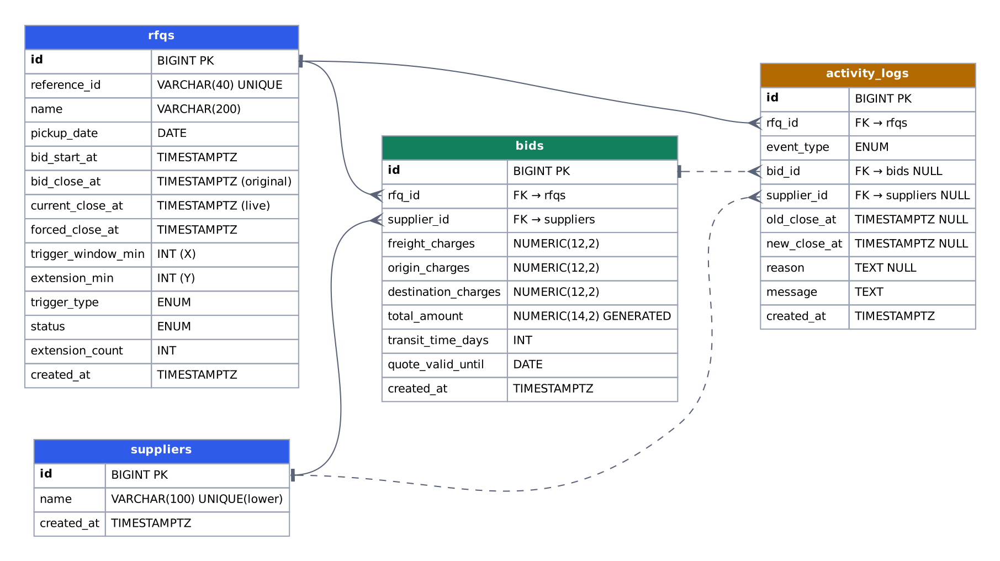

# Schema Design (PostgreSQL)



DDL: [`backend/app/schema.sql`](../backend/app/schema.sql) — idempotent, applied automatically when the API starts.
Conventions: timestamps `TIMESTAMPTZ` (UTC) · money `NUMERIC` (exact, no float rounding) · enums as Postgres `ENUM` types.

## Enum types

| Type | Values |
|---|---|
| `trigger_type` | `BID_RECEIVED`, `ANY_RANK_CHANGE`, `L1_CHANGE` |
| `auction_status` | `UPCOMING`, `ACTIVE`, `CLOSED`, `FORCE_CLOSED` |
| `activity_event` | `RFQ_CREATED`, `BID_SUBMITTED`, `TIME_EXTENDED`, `AUCTION_CLOSED`, `AUCTION_FORCE_CLOSED` |

## rfqs
One row per RFQ. Auction config (X, Y, trigger) is 1:1 with the RFQ, so it lives here.

| Column | Type | Notes |
|---|---|---|
| id | BIGINT IDENTITY PK | |
| reference_id | VARCHAR(40) UNIQUE | user-provided or auto `RFQ-00001` |
| name | VARCHAR(200) | |
| pickup_date | DATE | pickup / service date |
| bid_start_at | TIMESTAMPTZ | |
| bid_close_at | TIMESTAMPTZ | original close, never changes |
| current_close_at | TIMESTAMPTZ | live close, moved by extensions |
| forced_close_at | TIMESTAMPTZ | hard stop |
| trigger_window_min | INT | X, 1–1440 |
| extension_min | INT | Y, 1–1440 |
| trigger_type | trigger_type | |
| status | auction_status | cache of the time-derived status |
| extension_count | INT | default 0 |
| created_at | TIMESTAMPTZ | default `now()` |

Constraints:
- `chk_close_after_start`: `bid_close_at > bid_start_at`
- `chk_forced_after_close`: `forced_close_at > bid_close_at`
- `chk_current_close_range`: `current_close_at BETWEEN bid_close_at AND forced_close_at` — the DB itself refuses any extension past forced close.

Index: partial `idx_rfqs_open (current_close_at) WHERE status IN ('UPCOMING','ACTIVE')` for the sweeper.

## suppliers
| Column | Type | Notes |
|---|---|---|
| id | BIGINT IDENTITY PK | |
| name | VARCHAR(100) | carrier name; unique index on `lower(name)` |
| created_at | TIMESTAMPTZ | |

## bids
Every quote submission (full history). A supplier's current quote = their lowest (= latest) bid.

| Column | Type | Notes |
|---|---|---|
| id | BIGINT IDENTITY PK | |
| rfq_id | BIGINT FK → rfqs | `ON DELETE CASCADE` |
| supplier_id | BIGINT FK → suppliers | |
| freight_charges | NUMERIC(12,2) | ≥ 0 |
| origin_charges | NUMERIC(12,2) | ≥ 0 |
| destination_charges | NUMERIC(12,2) | ≥ 0 |
| total_amount | NUMERIC(14,2) | `GENERATED ALWAYS AS (freight + origin + destination) STORED`; > 0 |
| transit_time_days | INT | 1–365 |
| quote_valid_until | DATE | quote validity |
| created_at | TIMESTAMPTZ | tie-breaker for equal prices |

Indexes: `(rfq_id, total_amount, created_at, id)` for ranking / lowest bid, `(rfq_id, supplier_id)`.

Ranking query (L1..Ln):
```sql
SELECT best.*, ROW_NUMBER() OVER (ORDER BY total_amount, created_at, id) AS rank
FROM (SELECT DISTINCT ON (supplier_id) * FROM bids WHERE rfq_id = $1
      ORDER BY supplier_id, total_amount, created_at, id) best;
```

## activity_logs
Append-only audit trail shown on the details page.

| Column | Type | Notes |
|---|---|---|
| id | BIGINT IDENTITY PK | |
| rfq_id | BIGINT FK → rfqs | `ON DELETE CASCADE` |
| event_type | activity_event | |
| bid_id | BIGINT FK → bids NULL | bid that caused the event |
| supplier_id | BIGINT FK → suppliers NULL | |
| old_close_at | TIMESTAMPTZ NULL | extensions only |
| new_close_at | TIMESTAMPTZ NULL | extensions only |
| reason | TEXT NULL | e.g. `L1 changed within the last 10 min: Gati → VRL` |
| message | TEXT | human-readable line |
| created_at | TIMESTAMPTZ | |

Constraint `chk_extension_fields`: a `TIME_EXTENDED` row must have `old_close_at`, `new_close_at > old_close_at` and a `reason`.
Index: `(rfq_id, created_at, id)`.
